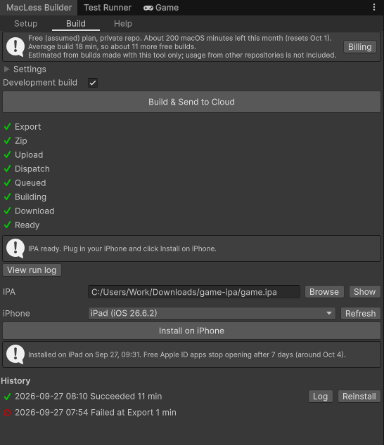
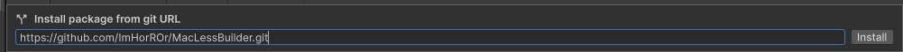
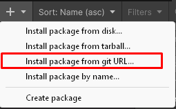
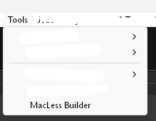
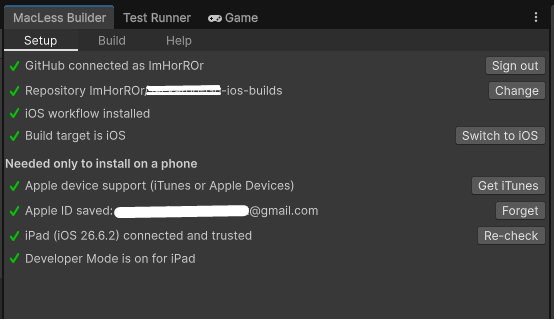
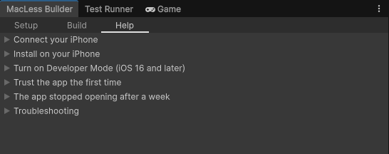
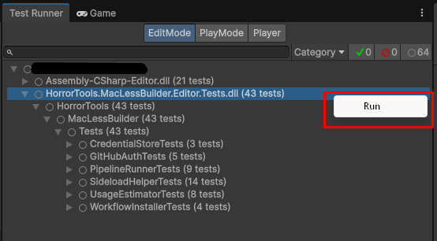
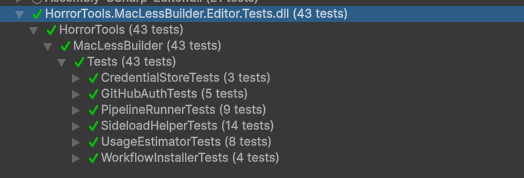

# MacLess Builder

Build your Unity game for iPhone from Windows, without owning a Mac.

MacLess Builder exports the Xcode project, compiles it on a GitHub Actions macOS runner in
**your own** GitHub repository, downloads the IPA, then signs it with a free Apple ID and installs
it on your iPhone over USB. Everything runs from one editor window: **Tools > MacLess Builder**.



Not affiliated with Apple, Unity or GitHub.

## Requirements

- Unity 6 on **Windows**, with the iOS Build Support module. Developed and tested on Unity 6.3;
  earlier Unity 6 versions should work but are untested.
- A GitHub account (free works). Builds run in a private repository the tool creates for you.
- To install on a phone: an iPhone or iPad, a data cable, iTunes or the Apple Devices app (for the
  USB driver), and an Apple ID (free works).

## Install

Pick one:

- **.unitypackage:** download `MacLessBuilder-<version>.unitypackage` from
  [Releases](https://github.com/ImHorROr/MacLessBuilder/releases), then **Assets > Import Package >
  Custom Package**. It lands in `Assets/HorrorTools/MacLessBuilder/`.
- **Git URL (updates through Package Manager):** Package Manager > **+** > **Install package from
  git URL**, then paste `https://github.com/ImHorROr/MacLessBuilder.git`. To pin a version, add
  `#v0.1.0` to the end.

  
  

Use one or the other in a project, not both.

## Quick start

1. Open **Tools > MacLess Builder**.

   

2. **Setup** tab, top to bottom:
   - **Use Git's login** (or **Sign in with GitHub**, see below).
   - **Create private repo**, then **Init iOS workflow**.
   - **Switch to iOS** if the project is not on iOS yet.
   - For installs: **Enter Apple ID**, then plug the iPhone in, unlock it and tap **Trust**.

   All green when you're done:

   

3. **Build** tab: **Build & Send to Cloud**. The build takes about 10-20 minutes; the IPA lands in
   `Builds/iOS/<date-time>/game.ipa`.
4. **Install on iPhone**. The first time, trust the developer on the phone
   (**Help > Trust the app the first time**).

Apps signed with a free Apple ID stop opening after 7 days. Click **Reinstall** in the history
list; no new cloud build is needed.

Stuck? The **Help** tab walks through connecting the phone, Developer Mode, trusting the app and
common errors.



## Signing in to GitHub

- **Use Git's login** reuses the account Git Credential Manager (bundled with Git for Windows) is
  signed in with, or opens its browser sign-in. Nothing to set up.
- **Sign in with GitHub** uses GitHub's device flow and needs the client id of an OAuth App with
  **Enable Device Flow** ticked and **Expire user access tokens** unticked. Paste it on the Setup
  tab, or, if you ship your own fork, put it in `DefaultClientId` in `Editor/GitHubAuth.cs`.

Scopes requested: `repo workflow`.

## Costs

The tool is free. GitHub charges for macOS runner minutes in private repositories beyond the
monthly allowance, and counts them 10x (the Free plan's 2,000 minutes are about 200 macOS minutes).
The Build tab shows the minutes left and asks before a build that would be billed. Without a
payment method on your GitHub account, GitHub blocks the build instead of charging. See GitHub's
[Actions billing](https://docs.github.com/en/billing/managing-billing-for-your-products/managing-billing-for-github-actions/about-billing-for-github-actions).

## What won't work

Installs are signed with a free Apple ID, which is for testing on your own devices only. Two things
follow from that:

- **The app gets only the entitlements of a free provisioning profile.** Whatever capabilities you
  enabled in Xcode or Unity are dropped, and a free account can't get most of them anyway.
- **The bundle id gets your team id appended** (`com.studio.game` becomes
  `com.studio.game.ABCDE12345`), because free accounts can't register an id someone else owns.

So these fail on a MacLess install, and will work once the app is built and signed with a paid
Apple Developer account:

- **In-App Purchases** (Unity IAP / StoreKit): products come from App Store Connect, which needs a
  paid account, and they're tied to the original bundle id. The store returns no products.
- **Sign in with Apple**
- **Game Center** (sign-in, leaderboards, achievements)
- **Push notifications** (remote). Local notifications work.
- **iCloud / CloudKit**, including iCloud key-value saves
- **Apple Pay and Wallet**
- **Universal Links / Associated Domains**
- **App Groups** and anything else that needs an entitlement (HealthKit, HomeKit, Siri, NFC, and
  so on)
- **Anything checked against your bundle id,** such as server-side receipt validation or API keys
  restricted to an iOS bundle id. The app also installs next to your App Store version instead of
  replacing it.
- **TestFlight and App Store uploads.** The IPA isn't signed for distribution.

Free Apple ID limits also apply: apps stop opening after 7 days (use **Reinstall**), at most 3
sideloaded apps on a device at once, and at most 10 new app ids per 7 days.

Everything that needs no entitlement and doesn't depend on the bundle id works: gameplay,
rendering, touch, audio, local saves, networking and local notifications.

## How it works

- **Build:** Export > Zip > Upload (release `ios-build-input`) > Dispatch > Queued > Building >
  Download. The state is saved in `Library/`, so a build survives domain reloads and editor
  restarts. Work files go to `Builds/iOS/Work/`; `/Builds/` is added to `.gitignore` if missing.
- **Install:** `Editor/Bin/sideload-helper.exe`, a small command-line program built on
  [isideload](https://github.com/nab138/isideload), registers the phone with Apple, creates a free
  development certificate, signs the app and installs it. The editor talks to it with JSON lines;
  the Apple ID password goes to its stdin, never its command line.

## Privacy

There is no backend. The tool talks to GitHub; the helper talks to Apple and to an anisette
server, which supplies the device data Apple's sign-in requires and never sees your password
(change the server under **Build > Settings**).

- GitHub token and Apple ID: Windows Credential Manager, targets `IosCloudBuild/GitHub` and
  `IosCloudBuild/AppleID` (named after the tool's first name). Remove them with **Sign out** and
  **Forget**, or in Control Panel > Credential Manager.
- The helper's signing certificate and anisette identity: Credential Manager, service
  `HorrorTools.IosCloudBuild`.
- Repository choice and build history: `UserSettings/IosCloudBuild.asset`, which Unity keeps out
  of version control, so teammates never share your repository or accounts.

## Running the tests

Unity hides tests from installed packages. To run them, install the Test Framework package
(`com.unity.test-framework`) and list the package under `testables` in your project's
`Packages/manifest.json`:

```json
{
  "dependencies": {
    "com.horrortools.maclessbuilder": "https://github.com/ImHorROr/MacLessBuilder.git#v0.1.0"
  },
  "testables": [
    "com.horrortools.maclessbuilder"
  ]
}
```

Then **Window > General > Test Runner > EditMode**, select
`HorrorTools.MacLessBuilder.Editor.Tests.dll` and click **Run**.




## License

MIT, see [LICENSE.md](LICENSE.md). The helper includes third-party code under other licenses,
including apple-codesign-quick under the LGPL; see [ThirdPartyNotices.md](ThirdPartyNotices.md).
